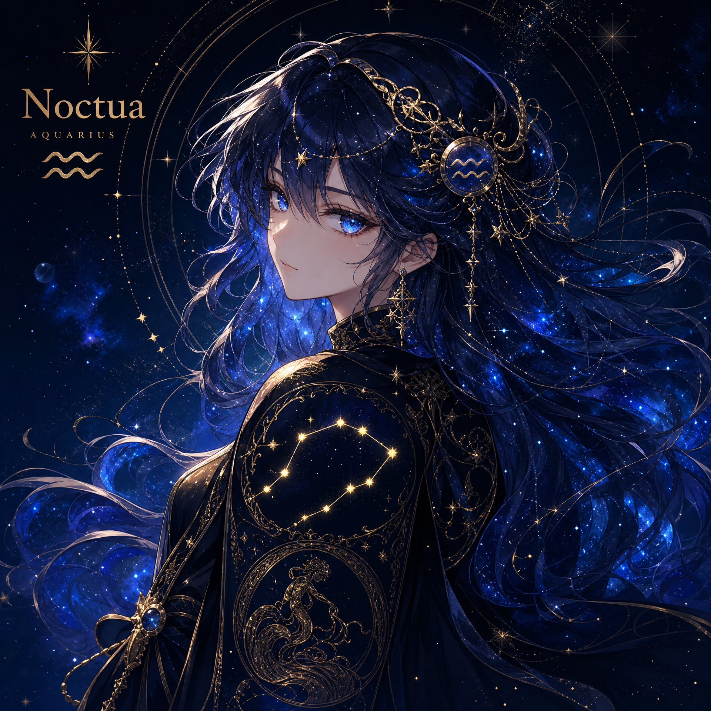
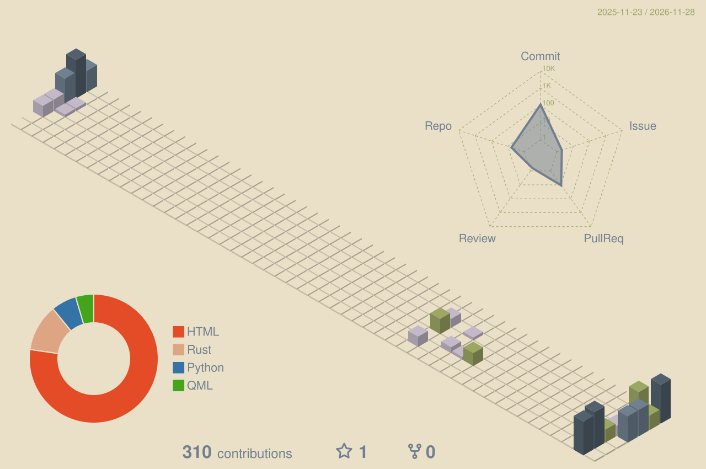

<picture>
  <source media="(prefers-color-scheme: dark)" srcset="./assets/noctua_editorial_header_twilight_editorial.png?v=2" />
  <source media="(prefers-color-scheme: light)" srcset="./assets/noctua_editorial_header_light_editorial.png?v=2" />
  
</picture>

  

# ✦ Noctua Lab ✦

### Compiling the night.

  <picture>
    <source media="(prefers-color-scheme: dark)" srcset="https://readme-typing-svg.demolab.com/?lines=Converting+starlight+into+source+code...;Linux+%C2%B7+Local+AI+%C2%B7+Software+Autonomy;Observing+systems+from+the+digital+zenith;Building+quiet+tools+for+noisy+worlds&font=Fira%20Code&center=true&vCenter=true&width=800&height=50&duration=3500&pause=900&color=FFEBC9&background=70809000" />
    <source media="(prefers-color-scheme: light)" srcset="https://readme-typing-svg.demolab.com/?lines=Converting+starlight+into+source+code...;Linux+%C2%B7+Local+AI+%C2%B7+Software+Autonomy;Observing+systems+from+the+digital+zenith;Building+quiet+tools+for+noisy+worlds&font=Fira%20Code&center=true&vCenter=true&width=800&height=50&duration=3500&pause=900&color=708090&background=EAE0C800" />
    
  </picture>

[English](./README.md) · [Português do Brasil](./README.pt-BR.md) · [Color system](./docs/PROFILE_PALETTE.md) · [Automation](./docs/PROFILE_AUTOMATIONS.md)

Experiments, tools, and systems built around **Linux, local AI, analog aesthetics, and software autonomy**.

---

## What I build

Noctua Lab is a personal open-source workspace for building and testing software around Linux desktops, local language models, developer tooling, and interface systems. The goal is simple: make the work visible through repositories, documentation, demos, and code that people can inspect and run.

## Stellar constellation

## Project map

| Area | Project | Role in the ecosystem |
|---|---|---|
| **Analog audio** | [**noctua-player**](https://github.com/NoctuaCoder/noctua-player) | Noctua — Analog Edition: Hi-Fi music player for Linux with reel-to-reel visual aesthetics, MPRIS integration, and local audio streaming. |
| **Linux desktop** | [**noctua-niri**](https://github.com/NoctuaCoder/noctua-niri) | The main desktop environment experiment: Niri dotfiles, QML components, Quickshell integration, spring animations, and Wayland workflows. |
| **Local AI infrastructure** | [**ArbiterAI**](https://github.com/NoctuaCoder/ArbiterAI) | A local runtime for coding agents that plans tasks, uses tools, integrates with Git, and executes work inside ephemeral Docker sandboxes. |
| **LLM tooling** | [**voidkitty-llm**](https://github.com/NoctuaCoder/voidkitty-llm) | A high-performance Rust tool for pulling GGUF models, managing llama-server processes, and serving local models through a web UI and OpenAI-compatible API. |
| **Local transfers** | [**noctua-drop**](https://github.com/NoctuaCoder/noctua-drop) | Fast peer-to-peer transfers between mobile and Linux workstations, local PDF optimizations, and automated HEIC to JPG conversion. |
| **Quiet diagnostics** | [**nocturne-forge**](https://github.com/NoctuaCoder/nocturne-forge) | Silent hardware telemetry, GPU offload verification, and local AI runtime diagnostics for Linux workstations. |

## Current focus

The priority is depth rather than quantity: make the existing projects easier to install, easier to understand, and easier to evaluate.

For `noctua-player` and `noctua-niri`, that means fluid tactile interfaces, audio fidelity, and seamless Wayland ergonomics. For `ArbiterAI` and `voidkitty-llm`, it means making sandbox boundaries, memory management, and inference pipelines transparent and deterministic.

## Evidence over adjectives

| Project | Concrete surface to explore |
|---|---|
| **noctua-player** | Analog tape/reel animations, MPRIS metadata handling, audio buffer pipelines, and lightweight QML/Python architecture. |
| **noctua-niri** | QML and Quickshell components, Niri configuration, visual previews, and installation scripts. |
| **ArbiterAI** | Docker sandbox isolation, local Ollama workflow, tool execution, Git integration, and task graph structure. |
| **voidkitty-llm** | GGUF model pulling, quantization selection, hot model serving, multi-model mode, and OpenAI-compatible API. |
| **noctua-drop** | Local P2P discovery, zero-cloud media handling, and instant format conversion. |

## Technical stack

| Area | Technologies |
|---|---|
| **Languages** | Rust · Python · TypeScript · Bash |
| **Systems** | Linux · Wayland · Niri · Hyprland · Docker |
| **AI** | llama.cpp · GGUF · Local LLMs · Autonomous Coding Agents |
| **UI & Audio** | QML · Quickshell · PipeWire · Analog UI |
| **Tooling** | Git · GitHub Actions · Neovim · uv |

## Nocturne Command Center

## Live systems dashboard

## Activity hubs

## Contribution trail

<picture>
  <source media="(prefers-color-scheme: dark)" srcset="https://raw.githubusercontent.com/NoctuaCoder/NoctuaCoder/output/github-contribution-grid-snake-dark.svg" />
  <source media="(prefers-color-scheme: light)" srcset="https://raw.githubusercontent.com/NoctuaCoder/NoctuaCoder/output/github-contribution-grid-snake.svg" />
  
</picture>

## 3D contribution constellation

<picture>
  <source media="(prefers-color-scheme: dark)" srcset="https://raw.githubusercontent.com/NoctuaCoder/NoctuaCoder/output-3d-contrib/night.svg" />
  <source media="(prefers-color-scheme: light)" srcset="https://raw.githubusercontent.com/NoctuaCoder/NoctuaCoder/output-3d-contrib/day.svg" />
  
</picture>

The native contribution graph is available on the [main profile](https://github.com/NoctuaCoder). Commits, releases, issues, installation notes, and implementation details live in each project repository.

## Contact

If you are interested in Linux desktops, local AI, Rust tooling, coding agents, analog interfaces, or QML systems, explore the projects and open a discussion in the repository that matches your interest.

`LOCAL SYSTEMS · OPEN SOURCE · PRACTICAL AI · ANALOG HARMONY`

