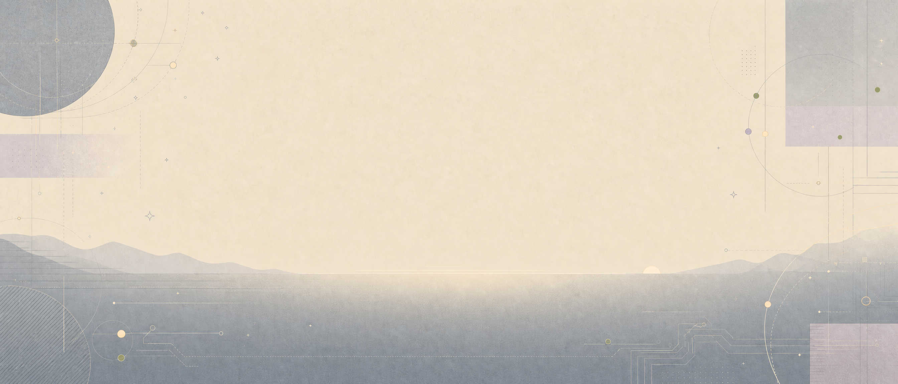
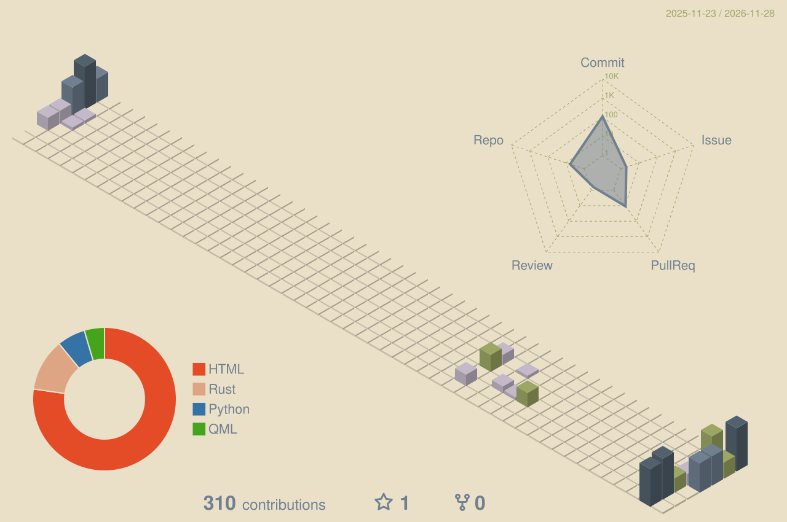

<picture>
  <source media="(prefers-color-scheme: dark)" srcset="./assets/noctua_editorial_header_twilight_editorial.png" />
  <source media="(prefers-color-scheme: light)" srcset="./assets/noctua_editorial_header_light_editorial.png" />
  
</picture>

# Noctua Lab

*Compiling the night.*

[English](./README.md) · [Português do Brasil](./README.pt-BR.md) · [Portfólio](https://noctuacoder.github.io/NoctuaCoder/portfolio.html)

Desenvolvo software para rodar na própria máquina. O Noctua Lab reúne ambientes Linux, ferramentas de IA local e interfaces pensadas para o uso diário, com código que você pode inspecionar e executar por conta própria.

## Projetos em destaque

**Desktop Linux** · [noctua-niri](https://github.com/NoctuaCoder/noctua-niri)

Um ambiente Niri com widgets do Quickshell, componentes QML e scripts de instalação.

**Infraestrutura de IA local** · [ArbiterAI](https://github.com/NoctuaCoder/ArbiterAI)

Um ambiente local para agentes de programação com execução isolada em Docker.

**Modelos locais** · [voidkitty-llm](https://github.com/NoctuaCoder/voidkitty-llm)

Ferramentas em Rust para baixar modelos GGUF e executá-los localmente com llama.cpp.

**Contribuição open source** · [termlens #178](https://github.com/vyncint/termlens/pull/178)

Adicionei um erro tipado para dimensões inválidas de terminal a uma ferramenta de testes para aplicativos de terminal.

## Bastidores do perfil

[Paleta visual](./docs/PROFILE_PALETTE.md) · [Automações do perfil](./docs/PROFILE_AUTOMATIONS.md) · [Conquistas no GitHub](https://github.com/NoctuaCoder?tab=achievements)

<picture>
  <source media="(prefers-color-scheme: dark)" srcset="https://raw.githubusercontent.com/NoctuaCoder/NoctuaCoder/output-3d-contrib/night.svg" />
  
</picture>

